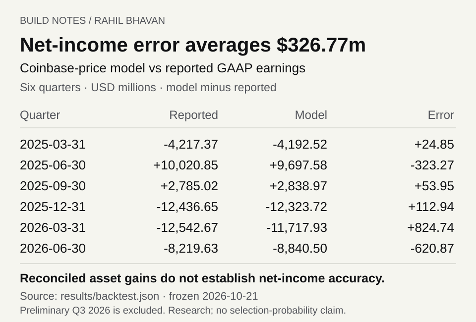

# Strategy fair-value earnings: bridge BTC accounting to an earnings eligibility screen

[](https://github.com/RahilBhavan/strategy-fair-value-earnings/actions/workflows/ci.yml)



A local Python model that rebuilds Strategy's BTC fair-value earnings bridge and tests the latest-quarter/trailing-four-quarter earnings condition used by S&P. Seeded scenarios estimate conditional frequencies of passing that screen. They do not estimate index selection probability. Financial cutoff: October 21, 2026; market candles end October 20.

## Results

- Latest reported quarter, June 30, 2026: net loss **$8,219,628,000**; trailing-four net loss **$30,413,926,000**. Both fail the earnings screen (`results/summary.json`).
- Filing-price asset-gain bridges reconcile six reported fair-value quarters after including sourced Q2 sale proceeds/cost removed. The broader Coinbase-price net-income model has **$326.77 million mean absolute error**; this remains material (`results/backtest.json`).
<!-- generated:thresholds start -->
- **Next pass price:** a Coinbase BTC-USD daily close (UTC) on 2026-12-31 above **$86,459** makes Q4 2026 (2026-12-31) and the four quarters ending then positive on GAAP net income, so the modelled screen passes at the 2027-03-19 checkpoint. After preferred dividends the price is **$88,826**. Q4 alone turns positive above $83,570; the trailing-four sum binds because Q1–Q3 2026 sum to -$1,747m (Q3 is a preliminary-estimate model) (`results/thresholds.json`).
- **Model error:** the price model missed reported net income by $326.77m on average (max $824.74m) over 6 quarters. Near the threshold, net income moves about $605k per $1 of BTC price, so the mean error equals about $540 and the max about $1,364 of BTC price. Treat closes within that band as undecided.
- **`pass_probability_base`** keys are assumed quarterly rebalance dates (third Friday of March, June, September and December), not announced dates. 2026-12-18 is 0.0 because no simulated price enters its window: Q3 2026 is modelled positive, but the four quarters ending September 30, 2026 sum to -$14.18bn. `pass_probability_base_reason` in `results/summary.json` states this for every date.
<!-- generated:thresholds end -->
- **Earnings basis:** the [S&P U.S. Indices Methodology](https://www.spglobal.com/spdji/en/documents/methodologies/methodology-sp-us-indices.pdf) (July 2026, p. 9; [archived copy](https://web.archive.org/web/20260908073946/https://www.spglobal.com/spdji/en/documents/methodologies/methodology-sp-us-indices.pdf), read 2026-10-22) requires that "Generally Accepted Accounting Principles (GAAP) net income from continuing operations must be positive for: the most recent quarter, and the sum of the most recent four consecutive quarters". It does not define the term or mention preferred dividends, so it does not settle the basis. Strategy's [June 2026 10-Q](https://www.sec.gov/Archives/edgar/data/1050446/000105044626000044/mstr-20260630.htm) (filed 2026-08-03) reports "Net (loss) income" (Q2: -$8,219,628 thousand) before "Dividends on preferred stock" ($400,661 thousand) and a separate "Net (loss) income attributable to common stockholders of Strategy". The model headlines the "Net (loss) income" line as the literal match and reports after-preferred figures as a sensitivity; S&P has not confirmed either reading. S&P's [Index Mathematics Methodology](https://web.archive.org/web/20261001061252/https://www.spglobal.com/spdji/en/documents/methodologies/methodology-index-math.pdf) (September 2026, p. 72) subtracts "Preferred Dividend and Other Adjustments" for its EPS data points, but that is not the eligibility rule.
- The September 2026 quarter uses preliminary company asset-gain/tax estimates plus modeled other income. It is not reported GAAP earnings.
- Three bootstrap regimes (resampled blocks of historical BTC daily returns: `demeaned` with zero drift, `raw` full history, `recent` last four years), preferred-burden sensitivities, price thresholds and simplified corporate alternative minimum tax (CAMT) scenarios rebuild locally. CAMT outputs distinguish the current fair value item (FVI) exclusion option in IRS Notice 2025-49 from counterfactual no-exclusion cases.

## How it works

`fve/xbrl.py` and `filings.py` load SEC facts; `earnings.py` bridges holdings, fair value, purchases/sales and a simplified tax proxy. `sp_rule.py` applies the positivity screen. `simulate.py` uses historical BTC return blocks. `camt.py` models simplified adjusted financial statement income (AFSI), CAMT applicability and tentative-tax sensitivities separately from GAAP deferred tax.

## Run it

Python 3.12+ and NumPy 2.3.4; tested with Python 3.14.7. From this repository:

```bash
git clone https://github.com/RahilBhavan/strategy-fair-value-earnings.git
cd strategy-fair-value-earnings
python3 -m venv .venv
.venv/bin/pip install -r requirements.txt
.venv/bin/python scripts/snapshot.py
.venv/bin/python scripts/verify_sources.py
.venv/bin/python -m unittest discover -s tests -v
.venv/bin/python scripts/run_model.py
.venv/bin/python scripts/render_result.py
```

Observed: **42 tests** (41 pass and the README-block check skips until `run_model.py` has written `results/`; all 42 pass on a rerun). `render_result.py` also rewrites the generated threshold lines in this README from `results/`. Package installation needs network access; source restoration/tests/demo are offline and need no credentials. Generated CSV/JSON stay local. A second run reproduces their hashes with the pinned NumPy version and seed. Optional source fetching needs contact-bearing `SEC_USER_AGENT` for EDGAR.

## Repository layout

- `fve/`: source loading, accounting, screen, bootstrap and CAMT models.
- `scripts/`: restore, verify, optional fetch and deterministic demo.
- `snapshot/`: compressed source/curated-fact archive.
- `provenance/`: source URL/date/hash inventories.
- `tests/`: source, accounting, missing-input and stochastic checks.
- `docs/`: scope, methodology, CAMT research and validation.

## Documentation

- [Public design system](DESIGN.md): Rahil Design 3.3.0, shared tokens and visual review rules.

- [Scope and acceptance](docs/spec.md): local v1 contract.
- [Earnings diagnostics](docs/earnings-diagnostics.md): signed component error bridge, chronological baseline comparisons and a five-minute example. Run `python scripts/diagnose_earnings.py`.
- [Methodology](docs/methodology.md): bridges, backtests and conditional scenarios.
- [CAMT research](docs/camt.md): AFSI exclusions, thresholds and omitted tax details.
- [Sources](docs/sources.md): primary-source checks and cache coverage.
- [Validation](docs/validation.md): exact checks and reproducibility.
- [Review](docs/review.md): proven fixes and source interpretation.
- [Publication](docs/publication.md): publication verification receipt.

## Sources

The snapshot contains 65 attributed response bodies: SEC filings/XBRL, Coinbase candles from July 2015 through October 20, 2026, and IRS/regulatory material. The July 2026 S&P methodology was checked in the browser; direct PDF download returned 403, so that PDF is not in the snapshot. Its earnings wording was rechecked on 2026-10-22 against the Internet Archive copy linked in Results. See [source notes](docs/sources.md) and `provenance/`.

## Scope and limits

- Independent research; no affiliation with Strategy or S&P. No investment or tax-return functionality.
- Only an earnings condition is modeled; other eligibility criteria and committee selection are excluded.
- Scenario frequencies depend on fixed holdings/cost, no future sales, assumed other income, tax proxy and return regime. No calibrated future-probability claim.
- AFSI is not GAAP earnings. Current guidance permits qualifying FVI exclusions subject to requirements. Simplified `camt` keys assume zero regular tax/credits and mean tentative-tax sensitivity, not actual liability or tax on every unrealized gain.
- The result table is generated from the backtest. Older partial figures are excluded.
- Optional source refresh is a new sample: it does not update curated facts or IRS guidance, and will fail the frozen-source checks. Keep it separate from reproduction.
- The October 28 daily-dividend proposal was pending at the snapshot; this model does not assume enactment.

## License

[MIT](LICENSE). The license covers this project's code only. Third-party source documents/data retain their owners' rights.

Part of [Rahil Bhavan's projects](https://github.com/RahilBhavan).
